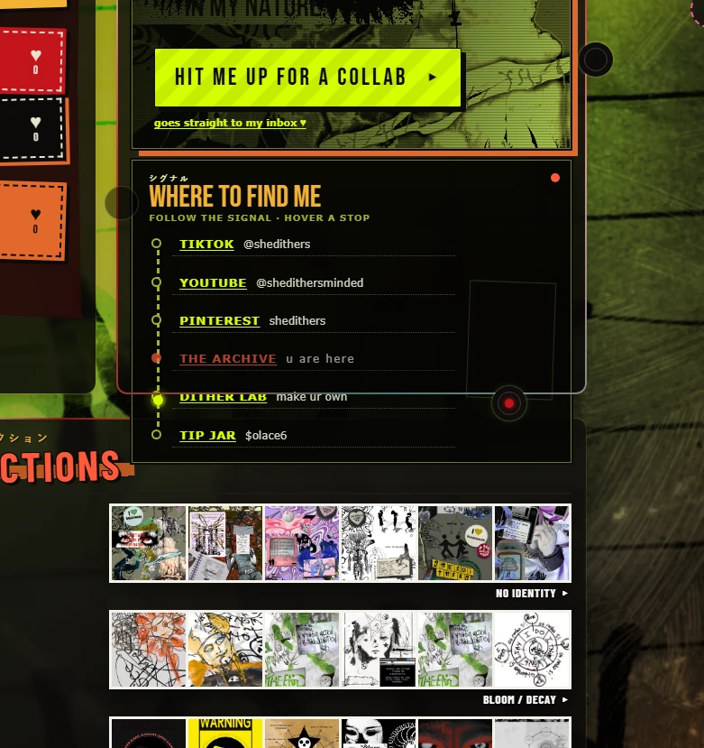
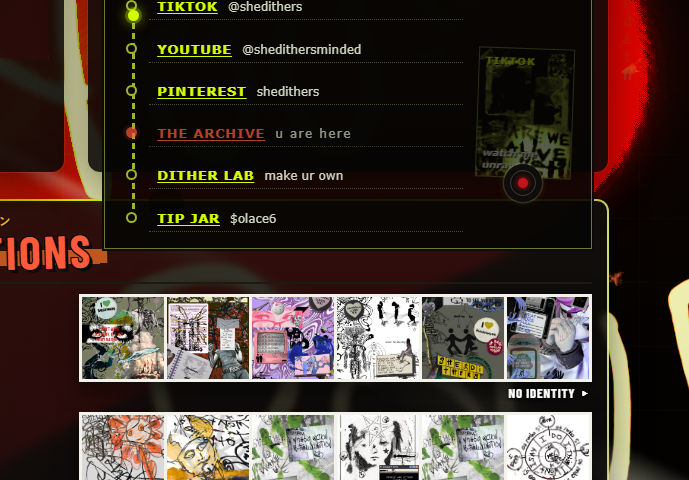
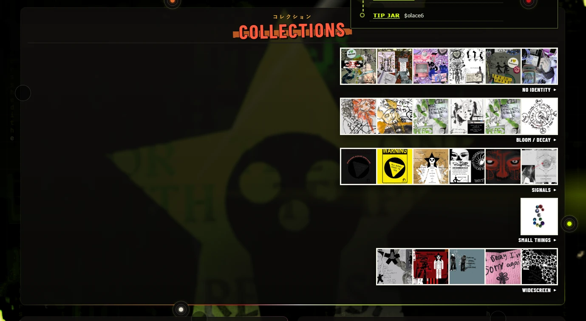

# SHEDITHERS archive remaster: handoff

Written 2026-11-20 after v3.5.0. Give this whole file (and the `shots/` folder next to it) to whoever picks the work up next, human or AI.

## The project in 30 seconds

- **What:** SHEDITHERS, an artist's own site. `archive.html` is the Artist Archive (the part this handoff is about). `index.html` is the Dither Lab editor.
- **Where:** `C:\CODE\shedithers` (git repo, branch `main`).
- **Live:** https://shedithersminded-sudo.github.io/shedithers/archive.html (GitHub Pages deploys on every push to `main`). Netlify (shedithers.netlify.app) is old/stuck; ignore it.
- **Stack:** plain HTML/CSS/JS, no build step. The archive is built from many layered files: `js/archive-*.js` and `css/archive-*.css`. Later files override earlier ones.
- **Main history doc:** `HANDOFF.md` in the project root (one line per version). Read its last ~20 lines first.
- **The artist's style:** blood red / black / torn paper, muted jewel colours (rust, mustard, moss, teal, faded blue, plum), acid lime `#d4ff00`, warm orange/red. Not cookie-cutter, not "AI-looking". Their own art is the UI. **SHEDITHERS is always one word.**
- **Writing rule:** no em dashes, no flowery copy in anything the visitor reads. Short, plain, lowercase-ish, in the artist's voice ("not ordinary. not in my nature.").

## How to run and test

1. Local server: `python -m http.server 8739 --directory C:/CODE/shedithers`, then open `http://localhost:8739/archive.html`.
2. Skip the intro while testing: in the browser console run
   `sessionStorage.setItem('shd.archive.in','1'); sessionStorage.setItem('shd.walked','1'); location.reload()`
   then click ENTER on the gate (or `document.getElementById('enter').click()`).
3. The service worker caches files. If changes don't show: unregister it and clear caches, or hard-reload with the files fetched `{cache:'reload'}`.
4. Test sizes: PC 1440x900, iPad 768x1024 and 1024x768, phone 375x812. Check for no sideways scroll and no floating buttons on top of each other.

## How to release

1. Bump the cache number on every css/js link in **both** `index.html` and `archive.html`: `?v=350` becomes `?v=351` (`sed -i 's/?v=350/?v=351/g' index.html archive.html`).
2. Bump `VERSION` in `sw.js` (`shedithers-v3.5.0` becomes `shedithers-v3.5.1`). Note: this had been forgotten for several releases and was stuck at v3.1.4 until v3.5.0.
3. Add one line to `HANDOFF.md`.
4. Commit with the message ending in `Co-Authored-By: Claude Opus 5.5 <noreply@anthropic.com>` (if an AI made it), push `main`.
5. Wait until `https://shedithersminded-sudo.github.io/shedithers/sw.js` serves the new VERSION (1 to 3 minutes).

## What v3.5.0 (the remaster) did

All in two files that load last, so nothing earlier was deleted:

- `css/archive-remaster.css`
- `js/archive-remaster.js`

1. **One clean home layout.** On PC (over 1100px) every panel has a fixed grid spot (see the `@media (min-width:1101px)` block). Row plan:
   1. logo (cols 1-8), news on the right (cols 9-12, rows 1-2)
   2. the deck (1-8)
   3. now playing (full width)
   4. comments (1-7) + collabs (8-12)
   5. collections (full)
   6. file directory (1-6) + Dither Lab promo on the right (7-12, rows 6-7)
   7. instant photo (1-6)
   8. the archive film (full)
   9. wallpaper art (1-8) + links (9-12)
   10. motion lab (1-6) + sign the list (7-12)
   11. word ticker (full)
   12. footer

   At 1100px and below everything is one column in the same order (`order:` rules). Tilts were turned off. Panels share one dark glass style.
2. **Glowing edges** on every panel: `js/archive-remaster.js` adds `<i class="rm-edge">` to each `.portal > .p-mod`. A conic-gradient light travels around the border (`@property --rm-a`), with a different colour pair per panel and full glow on hover.
3. **Code rain:** canvas `.rm-rain`, placed inside `#view` right after `.p-render` (the background art layer, which lives inside `#view`; that's why it can't sit on `body`). The letters are fixed per column so every column reads `s h e d i t h e r s` top to bottom. Opacity 16%, `mix-blend-mode: difference`, so it shows on both the bright yellow art and dark areas. It's paused when the tab is hidden and static for reduced-motion.
4. **Buy me a drink tab** (right edge): same art background (`assets/ui/dither-drink.png`) and torn shape. The cocktail emoji icon and sparkle are gone, and the artist's logo figure (`assets/ui/logo-paper-sm.png`, the lounging figure) sits on it. It's compact on phones. The 🍹 emoji in the footer, art viewer and about page buttons became ✦.

## What still needs fixing (with the artist's screenshots)

### 1. The Where To Find Me box sticks out of the Collabs panel

- **What's wrong:** the lower box (WHERE TO FIND ME) runs about 76px past the bottom of the Collabs panel and over the Collections panel. The panel's glowing edge ends mid-list (look at TIP JAR).
- **Why:** my remaster added `.portal>.p-collab .cl-grid{height:100%}` in `css/archive-remaster.css`. That makes the inner grid as tall as the whole panel, but it starts below the panel header, so it overflows. Measured at 1440px: the panel is 717px tall, while the grid starts 108px down and is 685px tall.
- **Fix:** delete that rule. Let the two collab boxes size naturally, or make `.p-collab` a flex column with `.cl-grid{flex:1}`. Then check that Comments and Collabs still line up at the same height.

### 2. The empty "peek" frame and the puzzle knob on top of it

- **What's wrong:** in WHERE TO FIND ME, the little art preview (`.fm-peek`, shows an art crop when you hover a stop) sits as an empty dark rectangle when nothing is hovered (screenshot 1, right side). When it does show art, a red puzzle knob (`.pz-knob`, from `js/archive-puzzle.js`) is drawn on top of it (screenshot 3).
- **Fix ideas:** hide the peek until a stop is hovered (opacity 0 instead of .35), or always show one default piece. Move the knob away from the peek (or skip knobs on `.p-collab`), and make sure knobs never sit over content. Knobs and sockets also overlap panel edges and gaps in general; consider making them smaller or only on the outer sides.

### 3. Collections has a huge empty space

- **What's wrong:** the Collections panel is full width, but each collection row (`.ps-row`, 6 thumbnails + title) sits on the right, so the left half is empty except the faint background art.
- **The artist wants:** use the space, ideally with animation.
- **Ideas (pick one, keep it in the artist's style):**
  - **Featured collection showcase** on the left: when you hover or tap a row, its pieces crossfade big on the left (dithered, slow, with the collection name in big type and a one-line description in the artist's words). Idle: auto-cycle through collections every few seconds.
  - **A rotating 3D stack** of the hovered collection's pieces (like the deck), on the left.
  - **Two columns:** put the rows in a 2-column grid so the panel fills evenly (simplest).
- Code: the collections panel is built in `js/archive-portal.js` (look for `p-strips` / `ps-row`). Add the showcase in a new file or in `archive-remaster.js`, styled in `archive-remaster.css`.

### 4. Fix the font

- **What's wrong:** the home page uses **14 different fonts** (counted on the live page): VT323, Bebas Neue, Barlow Condensed, Verdana, Patrick Hand, JetBrains Mono, Permanent Marker, Georgia, Tahoma, Rubik Wet Paint, Rubik Glitch, Arial, Michroma and generic sans-serif. That's a big part of why it looks messy.
- **The artist asked to "fix the font".** Confirm with them what they dislike before changing everything. A suggested system:
  - **Titles:** Bebas Neue (already the panel titles; keep the orange titles on the cut label).
  - **Body text:** one readable font (Barlow Condensed, or swap Verdana/Tahoma/Arial in News + Where To Find Me for it).
  - **Small labels / data:** JetBrains Mono.
  - **Handwritten accents only:** Patrick Hand (quotes, comments) and Permanent Marker (rare).
  - **Keep as special effects only:** VT323 in the File Directory (it's the retro computer look), Rubik Wet Paint / Rubik Glitch only in the comment bubbles.
  - **Drop:** Verdana, Tahoma, Arial, Georgia, Michroma from the home page.
- Do it in `css/archive-remaster.css` with targeted overrides, then check every panel at PC + phone sizes.

### 5. New art from TikTok (not done yet)

- The artist wants their newest TikTok posts shown. TikTok only shows the profile grid when logged in, and the browser was logged out.
- **Easier way:** ask the artist to paste the links to the new posts. For each link, TikTok's public oEmbed gives the cover image and caption with no login:
  `https://www.tiktok.com/oembed?url=<video link>` (JSON with `thumbnail_url`, `title`).
- Then add the links to `tiktokVideos` in `js/config.js` (the TikTok TV list, newest first) and, if the artist wants them in the archive grid too, add entries to `js/artworks.js` with a saved copy of the cover image in `assets/archive/` (only the artist's own posts).

## Don't break these (built earlier, the artist likes them)

- Intro: walk-in / blob tracking screen / portal, the captcha door ("select all squares with YOU", END always enters).
- The deck (3D cards, paper slips), the comment section (real TikTok comments in `tiktokComments` in `js/config.js`), now playing speaker, tip jar (NEWS-board style), collab form (sends through FormSubmit to the artist's inbox; it's activated for the GitHub Pages address), WHERE TO FIND ME, mess layer, TikTok TV, music player + song bar (one player at a time), tuck tabs (`js/tuck.js`), the puzzle look.
- The Dither Lab (`index.html`) has its own stained glass skin (`css/skin-glass.css`), separate from this work.

## Files to know

| File | What it is |
|---|---|
| `archive.html` | archive page, loads every archive css/js (remaster files last) |
| `css/archive-layout.css` | the previous home order + puzzle look (still loads; remaster overrides it) |
| `css/archive-remaster.css`, `js/archive-remaster.js` | v3.5.0 layout, glowing edges, code rain, drink tab |
| `js/archive-portal.js`, `css/archive-portal.css` | builds the home panels (logo, news, collections, links, etc.) |
| `js/archive-puzzle.js` | puzzle knobs/sockets on panels |
| `js/archive-collab.js`, `css/archive-collab.css` | collabs panel + WHERE TO FIND ME + collab form |
| `js/archive-watch.js` | music, song bar, tip jar modal, drink tab, drink spots |
| `js/config.js` | links, cashtag, TikTok videos + comments, drinks, tip lines |
| `HANDOFF.md` | version history, one line per release |
